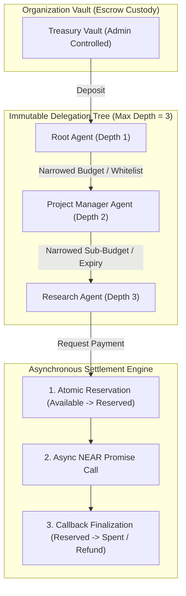

# ROOTBOUND: Hierarchical Budget Delegation & On-Chain Security for AI Agents on NEAR

[](https://near.org)
[](https://nearhackathon.com)
[](file:///c:/Users/wahab/rootbounds/tests)
[](#formal-security-invariants)
[](file:///c:/Users/wahab/rootbounds/contracts/rootbound)

> **ROOTBOUND** provides an immutable, on-chain policy and treasury guardrail that enables autonomous AI agents to earn, delegate, and spend money on NEAR **without granting them direct custody of master keys or unconstrained budgets**.

---

## 1. The Core Problem Solved

In multi-agent economies, autonomous AI agents (Project Managers, Researchers, Purchasing bots) must autonomously pay for compute, APIs, and sub-agents. 

However, **giving an autonomous AI agent unrestricted private keys or raw treasury access is catastrophic**:
1. **Prompt Injection & Hijacking:** Adversaries manipulate agent context into transferring funds to malicious addresses.
2. **Hallucination & Runtime Bugs:** Malformed transactions drain treasuries or overdraw balances.
3. **Rogue Delegation Loops:** Agents spawning endless sub-agents or laundering budgets.
4. **Asynchronous Double-Spending:** Concurrent agent requests exploiting NEAR block latency.

### The ROOTBOUND Solution
* **Zero Master Custody:** Treasury funds remain in an immutable escrow vault.
* **Strict Authority Attenuation (Narrowing Only):** Permissions can only become more restrictive down the delegation tree.
* **Max Delegation Depth = 3:** Strict architectural limit (`Root Treasury` $\rightarrow$ `Project Manager` $\rightarrow$ `Researcher`).
* **5-State Fund Accounting:** Eliminates double-spending and prevents funds from locking permanently on asynchronous transfer failure.
* **Instant Cascade Revocation:** Revoking an ancestor immediately paralyzes the entire downstream branch on-chain.

---

## 2. System Architecture



---

## 3. 5-State Balance Accounting & Invariant Math

To account for parent and child balances without double-counting, every agent node maintains 5 distinct dimensions:

$$\text{Allocated} \equiv \text{Available} + \text{Delegated} + \text{Reserved} + \text{Spent}$$

* **Allocated:** Total budget authority granted to this agent node.
* **Available:** Uncommitted funds ready for immediate payment or delegation.
* **Delegated:** Sub-budgets allocated downward to child agents ($\text{Delegated}_P = \sum_{C} \text{Allocated}_C$).
* **Reserved:** Funds locked in-flight for active NEAR cross-contract promises.
* **Spent:** Funds confirmed transferred upon successful callback.

### Safe Asynchronous Failure Recovery
If a cross-contract transfer fails on NEAR (`RECEIVER_PANIC`, `OUT_OF_GAS`, or `ACCOUNT_NOT_FOUND`), the callback safely transitions:
$$\text{Reserved} \longrightarrow \text{Available}$$
**Zero funds are lost or permanently locked.**

---

## 4. "Do X, See Y" Quickstart for AI Judges & Technical Reviewers

Designed to be reproduced deterministically by **Claude Code, Codex, and human judges**:

### Step 1: Run the Complete Automated Test Suite (63 Tests)
```bash
python -m unittest discover -s tests -p "test_*.py" -v
```
**Expected Output (See Y):**
```
Ran 63 tests in 0.047s
OK
```
*(All 63 tests pass with 0 failures, verifying all 13 adversarial attack vectors including cross-tenant isolation, fund reclamation, budget conservation, and 3-level depth limits.)*

---

### Step 2: Run the Official Interactive Demonstration
```bash
python scripts/run_demo.py
```
**Expected Output (See Y):**
* Initializes Root Treasury with 1,000,000 yoctoNEAR.
* Creates 3-tier hierarchy: `Root (1)` $\rightarrow$ `PM (2)` $\rightarrow$ `Researcher (3)`.
* Executes legitimate compute and LLM inference purchases (Happy Path).
* Triggers 6 adversarial attacks (Overspending, Recipient substitution, Depth 4 breach, Concurrency double-spend, Replay, Revocation) and prints structured on-chain rejections (`ERR_...`).
* Confirms: `Invariants 100% Satisfied: True`.

---

### Step 3: Run the System Integration Pipeline
```bash
python scripts/integrate.py
```
**Expected Output (See Y):**
```
======================================================================
ROOTBOUND: System Integration Pipeline Running
======================================================================
[1/5] Contract and 3-Tier Multi-Agent Hierarchy Initialized.
[2/5] Executing Legitimate Multi-Tier Agent Purchases...
      [OK] PM purchased decentralized compute (15,000 yoctoNEAR).
      [OK] Researcher purchased LLM inference (8,000 yoctoNEAR).
[3/5] Firing Adversarial Attacks Through Policy Engine...
      [DEFENDED] Attack 'overspend' -> Blocked with ERR_INSUFFICIENT_AVAILABLE_BUDGET
      [DEFENDED] Attack 'recipient_substitution' -> Blocked with ERR_UNAUTHORIZED_RECIPIENT
      [DEFENDED] Attack 'depth_exhaustion' -> Blocked with ERR_EXCEEDED_MAX_DEPTH
      [DEFENDED] Attack 'concurrency_race' -> Blocked with ERR_INSUFFICIENT_AVAILABLE_BUDGET
      [DEFENDED] Attack 'replay_nonce' -> Blocked with ERR_INVALID_NONCE
      [DEFENDED] Attack 'cascade_revocation' -> Blocked with ERR_ANCESTOR_REVOKED
[4/5] Verifying Global Invariants & State Synchronization Post-Attacks...
      [OK] Conservation Invariant Holds: Allocated == Available + Delegated + Reserved + Spent
[5/5] System Integration Successfully Verified!
======================================================================
```

---

### Step 4: Launch the Live Dashboard & Attack Simulator
```bash
python dashboard/server.py 8080
```
**Expected Output (See Y):**
```
ROOTBOUND Dashboard Server running at http://127.0.0.1:8080
```
* Open your browser to `http://localhost:8080`.
* View the real-time hierarchy tree, animated 5-state balance chips, and live on-chain audit ledger.
* Click attack buttons in the **Adversarial Attack Simulator** to trigger live on-chain rejections with structured error codes.

---

## 5. Adversarial Defense & Threat Matrix

| Attack Vector | Attacker Action | Contract Defense & Rejection Code |
| :--- | :--- | :--- |
| **Budget Overspending** | Agent requests payment > available balance | `ERR_INSUFFICIENT_AVAILABLE_BUDGET` |
| **Budget Escalation** | Child attempts to allocate sub-budget > parent authority | `ERR_BUDGET_EXCEEDS_PARENT_AUTHORITY` |
| **Payee Substitution** | Prompt injection diverts payment to hacker address | `ERR_UNAUTHORIZED_RECIPIENT` |
| **Depth Exhaustion** | Grandchild (Depth 3) attempts to spawn Depth 4 | `ERR_EXCEEDED_MAX_DEPTH` |
| **Race Double-Spend** | 2 concurrent requests compete for the same balance | Atomic Reservation lock; 2nd request rejected |
| **Replay Attack** | Attacker replays previously processed nonce | `ERR_INVALID_NONCE` |
| **Duplicate Callback** | Duplicate callback execution attempt | `ERR_INVALID_PAYMENT_STATE` |
| **Cascade Revocation** | Spend attempted through revoked ancestor | `ERR_ANCESTOR_REVOKED` |
| **Cross-Tenant Delegation** | Rogue tenant attempts to delegate from victim's agent | `ERR_UNAUTHORIZED_CALLER` |
| **Cross-Tenant Revocation** | Rogue tenant attempts to revoke victim's agent | `ERR_UNAUTHORIZED_CALLER` |
| **Inactive Org Freeze** | Spend/delegation attempted under paused organization | `ERR_ANCESTOR_REVOKED` |
| **Capital Lockup Vector** | Expired/revoked delegation traps available budget | Resolved via `reclaim_delegated_funds` |
| **Transfer / Withdrawal Failure** | NEAR receiver panics or runs out of gas | Safe Recovery: `Reserved` $\rightarrow$ `Available` |

---

## 6. Repository Structure

```
rootbounds/
├── contracts/
│   └── rootbound/                # NEAR Smart Contract (Rust near-sdk 5.5)
│       ├── Cargo.toml
│       └── src/
│           ├── lib.rs            # Contract entrypoints & asynchronous promises
│           ├── types.rs          # Data models & structured error codes
│           ├── policy.rs         # Attenuation & depth policy engine
│           ├── accounting.rs     # 5-state balance math
│           └── tests.rs          # Native Rust unit tests
├── core/
│   ├── types.py                  # Formal data types & error codes
│   ├── engine.py                 # Core reference state machine
│   └── async_payment_engine.py   # NEAR asynchronous promise simulation
├── agents/
│   └── economy.py                # Autonomous agent economy (PM, Researcher, Purchaser)
├── dashboard/
│   ├── server.py                 # HTTP Server & Attack Simulator API
│   └── static/
│       └── index.html            # Single-page web UI & visualizer
├── scripts/
│   ├── run_demo.py               # Official demonstration CLI runner
│   ├── integrate.py              # End-to-end integration pipeline
│   └── deploy_testnet.py         # NEAR Testnet deployment harness
├── tests/
│   ├── test_phase1.py            # Phase 1: Security model & invariants
│   ├── test_phase2_contract.py   # Phase 2: Core contract operations
│   ├── test_phase3_adversarial.py# Phase 3: 10 Adversarial exploit tests
│   ├── test_phase4_economy_and_dashboard.py # Phase 4: Agents & dashboard
│   └── test_phase5_system_integration.py    # Phase 5: End-to-end integration
├── docs/
│   ├── SECURITY_MODEL.md         # Formal security model & threat specification
│   ├── ARCHITECTURE.md           # System architecture & data models
│   └── SECURITY_VERIFICATION_REPORT.md # Formal invariant proofs & test report
├── HACKATHON.md                  # Hackathon track details & reproduction guide
└── README.md
```

---

## 7. License

MIT License. Built for the **NEAR HACKATHON 2026** (Track: AI Security & Defense).
